<!-- header:begin: brand-repos 0.1.0, variant studio, files in docs/brand/; the project-page sync drops this block -->
<picture>
  <source media="(prefers-color-scheme: dark)" srcset="docs/brand/readme-header-dark.svg">
  <source media="(prefers-color-scheme: light)" srcset="docs/brand/readme-header-light.svg">
  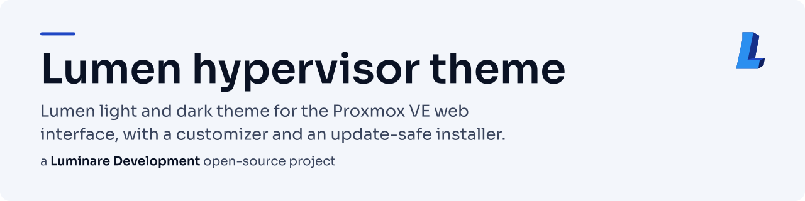
</picture>

<!-- byline:studio -->
*a [Luminare Development](https://luminare.tech/open-source/lumen-hypervisor-theme/) open-source project*
<!-- /byline:studio -->
<!-- byline:personal
*by Paul Pasaurek · [project page](https://luminare.tech/open-source/lumen-hypervisor-theme/)*
/byline:personal -->

<!-- header:end -->

# lumen-hypervisor-theme

Lumen light and dark theme for the Proxmox VE web interface, generated from the Lumen design
tokens, with a customizer page and an update-safe installer. It only adds its own CSS files to
the theme slot the interface already has; it does not patch or ship any Proxmox code.

Not affiliated with or endorsed by Proxmox Server Solutions GmbH. Proxmox VE is named only to
describe what the theme works with.

[](https://github.com/luminare-dev/lumen-hypervisor-theme/actions/workflows/ci.yml)
[](https://github.com/luminare-dev/lumen-hypervisor-theme/actions/workflows/themes.yml)
[](LICENSE)

<!-- screenshots:begin -->
| Dark | Light |
|---|---|
| 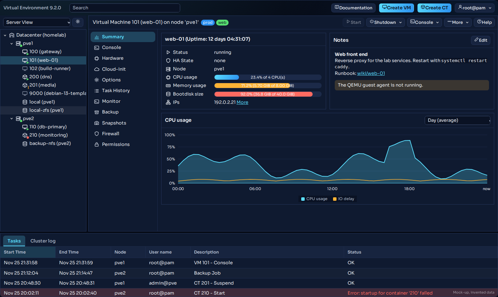 | 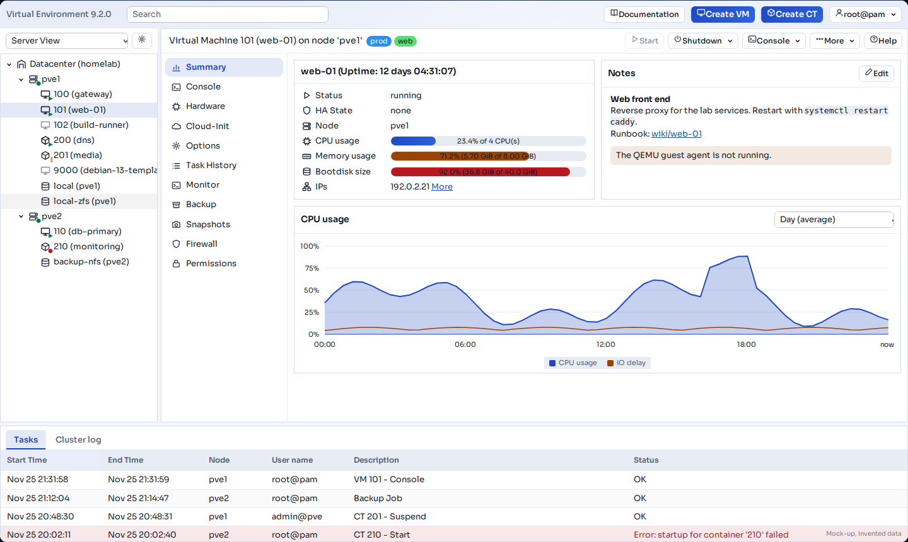 |
| 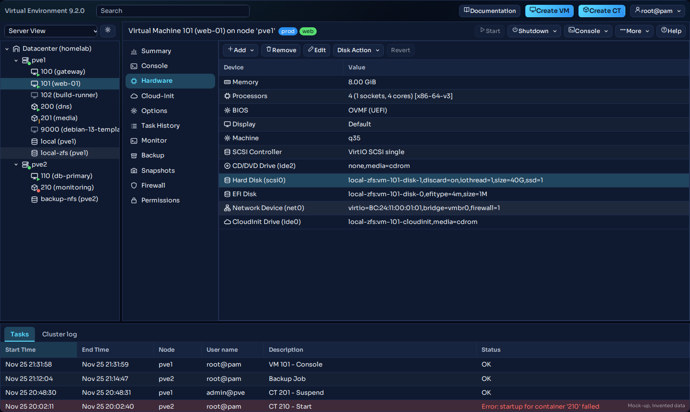 | 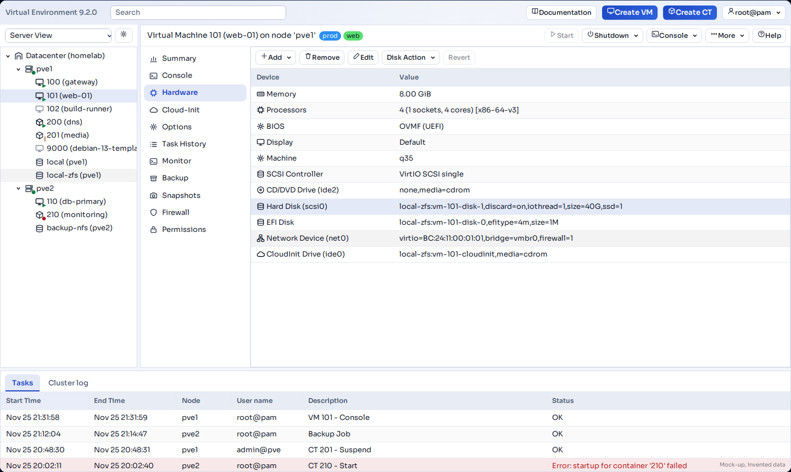 |
| 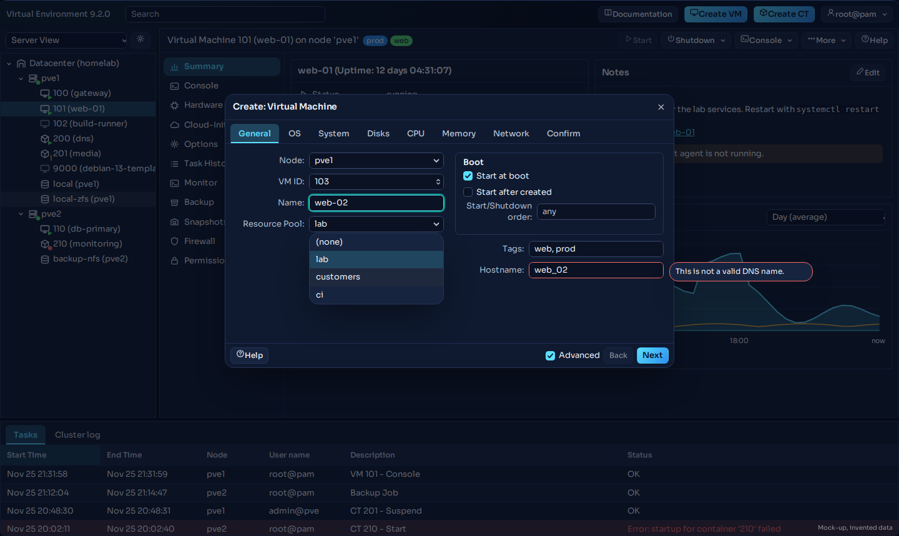 | 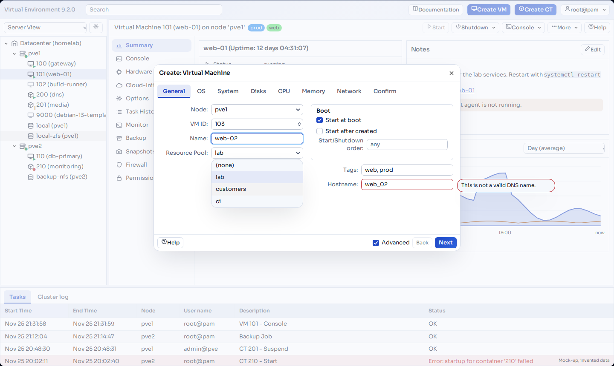 |
| 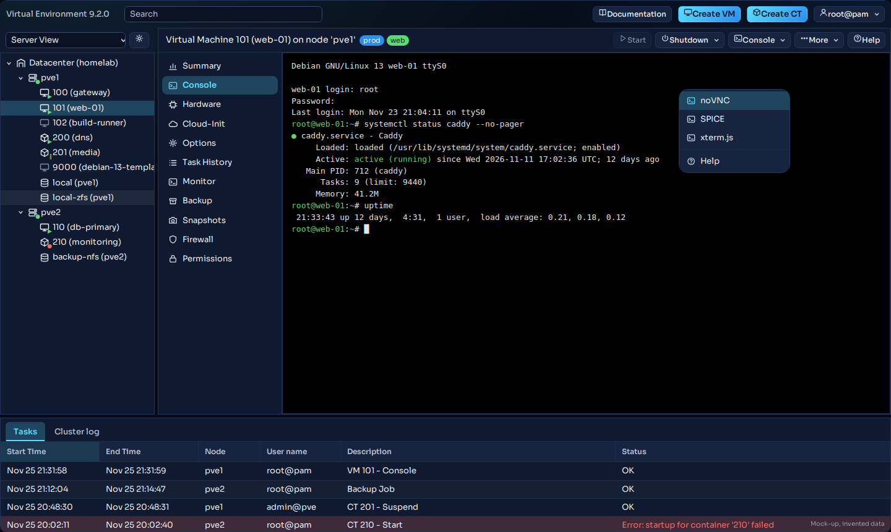 | 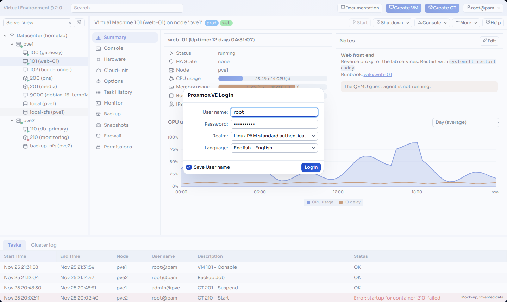 |
| 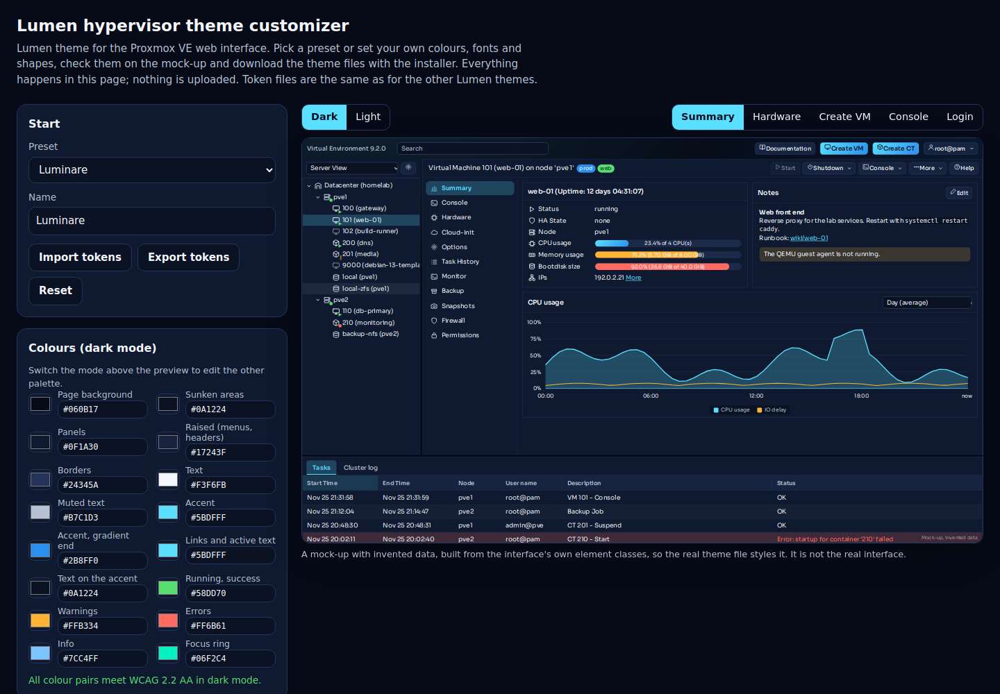 | 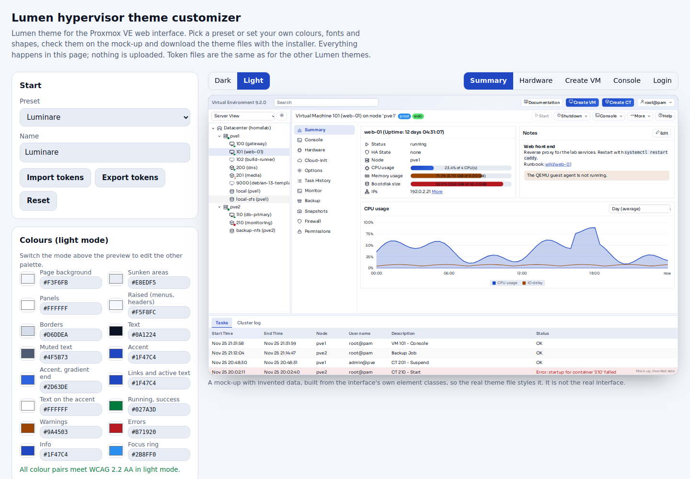 |

Screenshots from CI (the `screenshots` artifact of the `themes` workflow): the real theme files
on the customizer's mock-up of the interface, which uses the interface's own ExtJS element
classes, with invented example data.
<!-- screenshots:end -->

## Why

The web interface offers a light theme and Proxmox Dark. Most restyling guides patch package
files and break on the next update. The interface already loads `/pwt/themes/theme-<name>.css`
for whatever theme name is in the `PVEThemeCookie` cookie, so a theme can be three extra files and
nothing else.

## Features

- `lumen-dark`, `lumen-light` and `lumen-auto` (follows the system setting), covering the
  header, resource tree, grids, panels, toolbars, buttons, forms, check boxes, drop-downs, tabs,
  navigation lists, menus, tooltips, windows and wizards, masks and the login window, progress
  bars, charts and gauges, task logs, the date picker and the console frame.
- Built from the shared Lumen token schema: colours (16 roles per mode), fonts, text size,
  heading weight, corner radius, spacing and row density, shadows, borders, active-item style,
  background glow and custom CSS. Token files import and export like in the other Lumen themes.
- Presets Luminare, Graphite, Aurora and High contrast; contrast checked against WCAG 2.2 AA.
- [Customizer](customizer/index.html): one self-contained HTML file (no network, strict CSP) with
  a live mock-up, downloads the theme files, the installer and your token file as a ZIP.
- [Installer](install.sh): dry run by default, backups, uninstall; optional entries in the
  Color Theme dialog and an apt hook that re-applies them after updates.
- Sora font bundled (OFL), served by the node itself.

## Quickstart

On the node, as root:

```bash
git clone https://github.com/luminare-dev/lumen-hypervisor-theme.git
cd lumen-hypervisor-theme
./install.sh          # dry run: shows what would change
./install.sh --yes    # copies the theme files
```

Then open `https://<node>:8006/pwt/themes/lumen-theme.html` and pick **Lumen Dark**, **Lumen
Light** or **Lumen, following the system setting**. To have the themes in **user menu → Color
Theme** as well, see [docs/install.md](docs/install.md) (`--register`, optional `--hook`).

## How it works

| Path | What |
|---|---|
| `src/core.ts`, `src/presets/` | Shared Lumen token schema, validation and contrast checks, copied from lumen-hydrodactyl-theme and pinned in `shared.lock`. |
| `src/pve.ts` | Tokens → CSS variables for one mode (plain hex values, which the toolkit's charts need). |
| `src/structure.css` | The theme rules for the ExtJS components; they read only `--lumen-*` variables. |
| `scripts/build.mjs` | Builds `dist/` and `customizer/index.html` (Node 22.13+, no packages). |
| `dist/` | The Luminare build, ready for `install.sh`. |
| `customizer/` | `template.html` and the built, self-contained `index.html`. |
| `install.sh` | Installer, re-apply hook and uninstall. |
| `scripts/coverage.py` | Selector coverage against the toolkit's own dark theme. |
| `tests/` | Unit tests, installer tests in a fake root, module/page parity. |

CI builds every preset in every variant, checks the shared code against `shared.lock`, the
parity of the command-line build and the customizer page, the installer, the selector coverage
against the pinned upstream dark theme (currently about 94 % of the selectors it styles for
Proxmox VE views), lints, renders the mock-up in headless Chromium and keeps the screenshots.

## Limits

- The ExtJS desktop interface only. The mobile interface (`/yew-mobile/`) has its own styling.
- noVNC and xterm.js run in their own pages inside the console frame; only the frame is styled.
- The header keeps the product's own logo. Chart series colours come from the chart library.
- `--register` patches a file of the widget toolkit; without the apt hook every toolkit update
  removes the entries again (the theme files stay).

## Documentation

- [docs/install.md](docs/install.md): install, choose the theme, register, hook, uninstall.
- [docs/customize.md](docs/customize.md): the customizer, tokens, building from the command line.

## Licence

MIT for the code in this repository ([LICENSE](LICENSE)). Brand files, screenshots, the font and
the notes on Proxmox VE: see [NOTICE](NOTICE).

<!-- byline:studio -->
*a [Luminare Development](https://luminare.tech/open-source/lumen-hypervisor-theme/) open-source project*
<!-- /byline:studio -->
<!-- byline:personal
*by Paul Pasaurek · [project page](https://luminare.tech/open-source/lumen-hypervisor-theme/)*
/byline:personal -->
